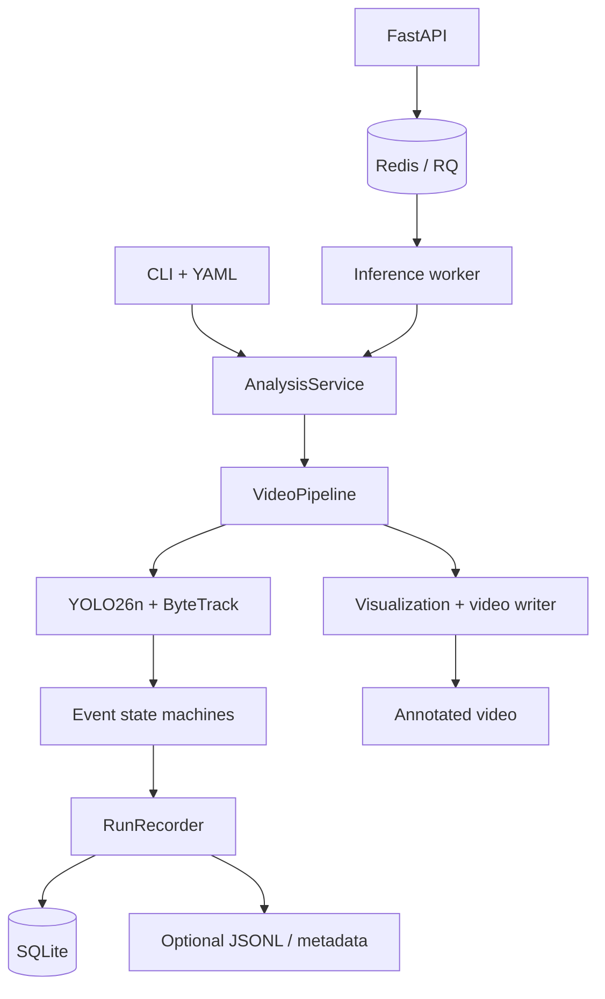

# Architecture And Operation

VisionGuard has one video pipeline shared by direct CLI execution and a trusted-local
queued HTTP service. SQLite is the persistence source of truth; JSONL is optional.

## Runtime



| Module | Responsibility |
| --- | --- |
| `src/config.py` | Validate YAML model/tracker, geometry, event, video and output settings. |
| `src/pipeline/video_pipeline.py` | Frame loop, resource cleanup, event dispatch and timing. |
| `src/tracking/` | ByteTrack adapter, track history, diagnostics and optional continuity/deduplication. |
| `src/events/` | Independent line-crossing, intrusion and loitering state machines. |
| `src/visualization.py` | Overlays; no event decisions. |
| `src/video.py` | OpenCV or NVENC encoding; bounded async queue and failure propagation. |
| `src/analysis_service.py` | Shared job creation/execution used by CLI and worker. |
| `src/run_recorder.py`, `src/database/` | Persist lifecycle, events, configuration and diagnostics. |
| `src/api/`, `scripts/run_worker.py` | Local path-based requests, query/download API and RQ worker. |
| `src/evaluation/`, evaluation scripts | MOT metrics, camera/public benchmarks and evidence metadata. |

Each pipeline run resets identities, track history and event state. Reusing a loaded model
does not carry identities from one input video to another. Event timestamps use video frame
time, not inference wall-clock time.

## Configuration

Explicit CLI values override YAML values. The selected tracking baseline is
`configs/person_tracking_final.yaml`: CrowdHuman `best.pt`, confidence 0.55, ByteTrack with
`configs/bytetrack_week6.yaml`, and no camera-specific events, continuity or duplicate
suppression. This is the configuration used for the promoted detector's tracking workflow.

`default.yaml`, `week4_video_{a,b,c}.yaml` and `week6.yaml` retain historical event/camera
setups. Their detector thresholds and scene geometry are not universal defaults. Geometry
must match the source resolution and camera view. Polygon validation rejects duplicate
vertices and self-intersections; line endpoints must differ.

### Event Semantics

- **Crossing:** the bottom-center of a tracked box changes stable side and crosses the
  finite line segment. Dead-zone and consecutive side confirmation reduce jitter. Direction
  mapping determines IN/OUT; the engine maintains IN, OUT and NET counts.
- **Intrusion:** a tracked outside-to-inside transition meets entry confirmation. First
  observation inside initializes state without an alert. Confirmed exit re-arms later entry;
  polygon boundary points count as inside.
- **Loitering:** time inside the ROI reaches the dwell threshold, once per visit. It means
  dwell time, including movement, rather than detection of a stationary person. Exiting
  resets a visit; tracking gaps and replacement IDs can affect its duration.

Optional continuity and duplicate handling are bounded position/motion heuristics, not
appearance-based person re-identification. They remain disabled in the frozen baseline and
need scene-specific validation. Detection/tracking benchmarks do not directly validate
crossing or intrusion on a new ROI.

## Artifacts, Persistence And Reliability

`analysis_runs` stores run ID, lifecycle, paths, resolved config, counters, errors and
performance diagnostics. `events` stores timestamp/frame, track ID, type, direction and zone.
JSONL event and metadata exports must be configured together and share the SQLite run ID.

The API generates `output_root/<run_id>/annotated.mp4`, preventing clients from selecting
shared output names. Its lifecycle is `queued → running → completed/failed`. Completed runs
expose counters, analytics and downloads; failed runs retain an error message.

The async writer uses a bounded queue. FFmpeg stderr is drained continuously; timeouts and
encoder failures propagate to the run. NVENC failure does not silently select another
encoder. Original source FPS, core-processing FPS, end-to-end FPS and stage timings are
distinct: playback FPS is not a processing-speed measurement.

## Optional Local HTTP Service

The CLI needs no Redis service. To use queued API jobs, activate `visionguard`, run from the
repository root, and configure existing server-owned paths in the API terminal:

Place source clips in `data/videos/` and create that directory if it is absent in a fresh clone.

```powershell
$env:VISIONGUARD_SOURCE_ROOT = (Resolve-Path data/videos).Path
$env:VISIONGUARD_CONFIG_ROOT = (Resolve-Path configs).Path
$env:VISIONGUARD_OUTPUT_ROOT = Join-Path (Get-Location) "data/outputs"
docker compose up -d redis
python -m uvicorn src.api.app:app --host 127.0.0.1 --port 8000
```

In another activated terminal:

```powershell
python -m scripts.run_worker
```

Submit an absolute `source_path` and `config_path` using Swagger at
`http://127.0.0.1:8000/docs`. Source/config paths are resolved within the configured roots.
Default roots are `C:/VisionGuard/videos`, `C:/VisionGuard/outputs` and
`C:/VisionGuard/configs`; environment overrides allow another storage layout.

| Endpoint | Purpose |
| --- | --- |
| `GET /health` | SQLite liveness/connectivity. |
| `GET /readiness` | Writable storage/database, Redis and live worker availability. |
| `POST /analyze` | Queue a local video/config job; return `run_id` and `queued`. |
| `GET /runs`, `GET /runs/{run_id}` | Paginated history and lifecycle. |
| `GET /runs/{run_id}/analytics` | Final counters, event aggregates and tracking diagnostics. |
| `GET /events` | Paginated events with run/type filters. |
| `GET /runs/{run_id}/output` | Download completed output, if the file is present. |

`/readiness` reports FFmpeg/NVENC capabilities in addition to required service checks.
API startup does not mark another worker's active run as failed. Windows uses a heartbeat
thread with RQ's in-process `SimpleWorker`; other platforms use the standard RQ worker.

Redis uses append-only persistence via `compose.yaml`. `docker compose stop redis` stops
the service; `docker compose down` removes its container while preserving the named volume.
The API is a trusted-local adapter without authentication or browser-upload functionality.
